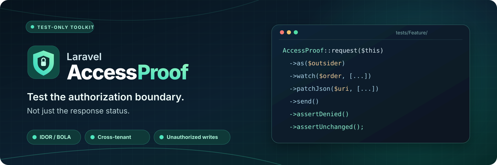

<p align="center">
  
</p>

<h1 align="center">Laravel AccessProof</h1>

<p align="center"><strong>Test what users can actually access — and what denied requests might still change.</strong></p>

<p align="center">
  <a href="https://github.com/mykholy/laravel-accessproof/actions/workflows/tests.yml"></a>
  <a href="https://github.com/mykholy/laravel-accessproof/releases"></a>
  <a href="https://packagist.org/packages/mykholy/laravel-accessproof"></a>
  <a href="https://packagist.org/packages/mykholy/laravel-accessproof"></a>
  <a href="composer.json"></a>
  <a href="composer.json"></a>
  <a href="LICENSE"></a>
</p>

<p align="center">
  <a href="#installation">Installation</a> ·
  <a href="#quick-start-an-ownership-regression-test">Quick start</a> ·
  <a href="#check-unauthorized-writes">Unauthorized writes</a> ·
  <a href="docs/SCENARIOS.md">Scenarios</a> ·
  <a href="docs/FIELD_REPORT.md">Field report</a>
</p>

AccessProof is a small, test-only Laravel package for **runtime authorization regression testing**. It runs real in-process HTTP requests using your application's routes, authentication and authorization rules, then asserts the expected response and, where requested, the persisted database state.

It is particularly useful for catching **broken object-level authorization (BOLA/IDOR)**, cross-tenant record access and writes that occur **before** a controller returns a denial.

**AccessProof does not create permissions or policies.** It tests the behavior of the ones your application already has. It is not a route crawler or a security certification tool.

For an anonymized example used against a real SaaS codebase, read the [multi-tenant field report](docs/FIELD_REPORT.md). The package ran against real Laravel routes on disposable SQLite and MySQL 8 databases: **34 integration tests and 86 assertions on each engine**. The host application repository is private.

## Why it exists

Consider a controller that updates an order and *then* responds with HTTP 403. A status-only test passes, even though the record was changed. AccessProof can combine the response assertion with a database snapshot:

```php
AccessProof::request($this)
    ->as($outsider)
    ->watch($order, ['tenant_id', 'status'])
    ->patchJson('/api/orders/'.$order->getKey(), ['status' => 'paid'])
    ->send()
    ->assertDenied()
    ->assertUnchanged();
```

The test fails if the response is not 403/404 **or** the watched record changed. No special application middleware is installed.

## Installation

Requires PHP **8.3+** and Laravel **12 or 13**.

```bash
composer require --dev mykholy/laravel-accessproof:^1.2
```

Install it in **require-dev**, not in production dependencies. No configuration, migration, service provider or Artisan command is required. Use it from your application's Laravel Feature Tests (PHPUnit).

## Quick start: an ownership regression test

This example assumes your application already has an `Order` model, a `User` model, factories and a protected `GET /api/orders/{id}` route. Adapt the fields and endpoints to your project:

```php
<?php

namespace Tests\Feature;

use App\Models\Order;
use App\Models\User;
use Mykholy\AccessProof\AccessProof;
use Tests\TestCase;

final class OrderAuthorizationTest extends TestCase
{
    public function test_a_user_cannot_read_another_tenants_order(): void
    {
        $owner = User::factory()->create(['tenant_id' => 20]);
        $outsider = User::factory()->create(['tenant_id' => 10]);
        $order = Order::factory()->create(['tenant_id' => 20]);

        $uri = '/api/orders/'.$order->getKey();

        // Positive control: prove this route exists and the owner can use it.
        AccessProof::request($this)
            ->as($owner)
            ->getJson($uri)
            ->send()
            ->assertAllowed();

        // Cross-tenant control: the other tenant must be denied.
        AccessProof::request($this)
            ->as($outsider)
            ->getJson($uri)
            ->send()
            ->assertDenied();
    }
}
```

**Why the positive control matters:** `assertDenied()` accepts 403 or 404, because some applications intentionally return 404 for inaccessible records. A nonexistent route can also return 404. Always verify the same route with an authorized user in a separate control.

## Verified read boundaries (recommended)

A plain `assertDenied()` can pass on a missing route because it accepts HTTP 404. For sensitive GET endpoints, prefer a **paired owner/outsider verification** that first proves the route works for the owner:

```php
AccessProof::compareRead($this)
    ->owner($owner)
    ->outsider($outsider)
    ->getJson('/api/orders/'.$order->getKey())
    ->withoutBodyMarker('ACCESSPROOF_TEST_SECRET_42')
    ->verify();
```

This issues two real Laravel GET test requests to the **same URI**. The owner must receive HTTP 200 (or another 2xx status configured with `expectedOwnerStatus(204)`); the outsider must receive 403/404. When a protected marker is supplied, it must not occur in the outsider's response body.

The check is deliberately GET-only. Use your usual tests to prove writes are authorized, and use the explicit `watch()` / `watchCount()` assertions below to detect side effects on denied writes. Authentication and tenant context are still managed by the host application; the outsider remains authenticated at the end of the comparison.

## Check unauthorized writes

### Updates and deletes of existing rows

Call `watch()` before `send()`. You can name specific columns, or omit the list to watch all persisted columns:

```php
AccessProof::request($this)
    ->as($outsider)
    ->watch($order, ['status', 'tenant_id'])
    ->patchJson('/api/orders/'.$order->getKey(), ['status' => 'paid'])
    ->send()
    ->assertForbidden()
    ->assertUnchanged();
```

`assertUnchanged()` performs unscoped SQL reads of the watched row after the request. It can detect updates or deletion of that row even if a tenant global scope would normally hide it. It does **not** watch every record in the database.

### Creates and deletes that change a row count

Use `watchCount()` to check the size of a selected set. It is useful when a denied POST must not insert rows:

```php
AccessProof::request($this)
    ->as($outsider)
    ->watchCount('orders', ['tenant_id' => $targetTenantId])
    ->postJson('/api/orders', [
        'tenant_id' => $targetTenantId,
        'status' => 'pending',
    ])
    ->send()
    ->assertDenied()
    ->assertUnchanged();
```

A count watch detects **net row-count changes only**. It cannot detect updates or an insert plus delete that cancel each other out. The optional third argument selects a named Laravel database connection.

### A whole tenant's rows (detects net-zero replacements)

`watchCount()` cannot detect a delete followed by an insert when the total number of rows stays unchanged. `watchRows()` takes a bounded snapshot of the identities and selected column values of every row matching an explicit predicate:

```php
AccessProof::request($this)
    ->as($outsider)
    ->watchRows('orders', ['tenant_id' => $targetTenantId], ['status', 'total'])
    ->postJson('/api/orders/batch-action')
    ->send()
    ->assertDenied()
    ->assertUnchanged();
```

It detects changed rows, deleted rows, new rows, and same-count replacements within the matching set. By default it uses an `id` primary key; a different single-column key can be passed as the fifth argument, after the optional connection. **The equality predicate is required**, SQL column names must be simple unqualified identifiers, and a snapshot is limited to **500 matching rows** to avoid unbounded database reads. Select only the columns you need. For larger datasets, narrow the predicate or write a dedicated integration assertion. It does not track activity outside the specified predicate.

### Response-body disclosure

If a resource contains a unique synthetic marker, assert that it never appears in an unauthorized response:

```php
AccessProof::request($this)
    ->as($outsider)
    ->getJson('/api/orders/'.$order->getKey())
    ->send()
    ->assertDenied()
    ->assertBodyDoesNotContain('ACCESSPROOF_TEST_SECRET_42');
```

Use a deliberately created fixture marker, not real credentials or customer data.

## API reference

| Method | Behavior |
| --- | --- |
| `AccessProof::request($this)` | Begin a single-use probe from a Laravel PHPUnit Feature TestCase |
| `AccessProof::compareRead($this)` | Begin a paired owner/outsider GET verification |
| `as($user, $guard = null)` | Authenticate the given user (optionally with a named guard) |
| `withHeaders(['X-Key' => 'value'])` | Include request headers |
| `getJson($uri)` | Configure a GET request |
| `postJson($uri, $data)` | Configure a POST request |
| `putJson($uri, $data)` | Configure a PUT request |
| `patchJson($uri, $data)` | Configure a PATCH request |
| `deleteJson($uri, $data)` | Configure a DELETE request |
| `watch($model, $columns = [])` | Snapshot an existing Eloquent record |
| `watchCount($table, $where = [], $connection = null)` | Snapshot the matching SQL row count |
| `watchRows($table, $where, $columns = [], $connection = null, $keyColumn = 'id')` | Watch matching row identities and values, limited to 500 rows |
| `send()` | Execute one in-process request and obtain a probe result |
| `assertAllowed($status = 200)` | Assert an expected authorized status |
| `assertDenied()` | Assert HTTP 403 or 404 |
| `assertForbidden()` | Assert HTTP 403 specifically |
| `assertUnauthenticated()` | Assert HTTP 401 specifically |
| `assertBodyDoesNotContain($marker)` | Ensure the raw response body omits a marker |
| `assertUnchanged()` | Ensure every watched row/count is unchanged |
| `response()` | Access Laravel's underlying `TestResponse` |

Paired comparisons support `owner($actor, $guard = null)`, `outsider($actor, $guard = null)`, `getJson($uri)`, `expectedOwnerStatus($status)`, `withoutBodyMarker($marker)`, and `verify()`.

Each probe accepts exactly **one request** and cannot be reused after `send()`. Probe configuration must happen before sending.

## Safety and limitations

- **Test environment only.** AccessProof refuses to send requests unless Laravel reports `APP_ENV=testing`. That check cannot detect a misconfigured database connection. **Never point the testing environment at a production database.**
- **Explicit scenarios only.** It does not discover all routes or prove full authorization coverage; you must write tests for meaningful actor/resource/action combinations.
- **HTTP response is not the whole story.** Always pair denial assertions with owner controls and, for writes, relevant persisted-state watches.
- **No asynchronous or external side-effect monitoring.** Queues, remote APIs, emails, files and other databases are not observed unless explicitly checked by your host test.
- **Watch what matters.** An unwatched row or a transient mutation later reverted can escape detection. Use `watchRows()` rather than `watchCount()` for net-zero replacements; it covers only your bounded predicate.
- **Authentication persists in the host test case.** `as()` uses Laravel's `actingAs()`. Put guest tests in a fresh test method instead of assuming another probe automatically logs out.

See [Testing scenarios](docs/SCENARIOS.md) and [Architecture / trust boundaries](docs/ARCHITECTURE.md) for practical guidance.

## Compatibility and quality checks

| PHP | Laravel | CI |
| --- | --- | --- |
| 8.3 | 12 | Automated |
| 8.4 | 12 | Automated |
| 8.3 | 13 | Automated |
| 8.4 | 13 | Automated |

The CI suite also exercises SQLite, MySQL 8 and PostgreSQL 16, and installs the package in an independent Laravel 13 application. [View the current CI results](https://github.com/mykholy/laravel-accessproof/actions/workflows/tests.yml).

For local development:

```bash
git clone https://github.com/mykholy/laravel-accessproof.git
cd laravel-accessproof
composer install
composer test
composer analyse
composer format-check
```

## Support and contributing

Bug reports, feature requests and reproducible authorization scenarios are welcome in [GitHub Issues](https://github.com/mykholy/laravel-accessproof/issues). Pull requests should include a regression test that fails when the issue is present.

For security-sensitive reports, read [SECURITY.md](SECURITY.md) before posting publicly. See [CONTRIBUTING.md](CONTRIBUTING.md) and the [changelog](CHANGELOG.md).

Maintained by **[Ahmed El-Kholy](https://github.com/mykholy)** · [LinkedIn](https://www.linkedin.com/in/mykholy/) · [Releases](https://github.com/mykholy/laravel-accessproof/releases)

MIT © 2026 Ahmed El-Kholy.
